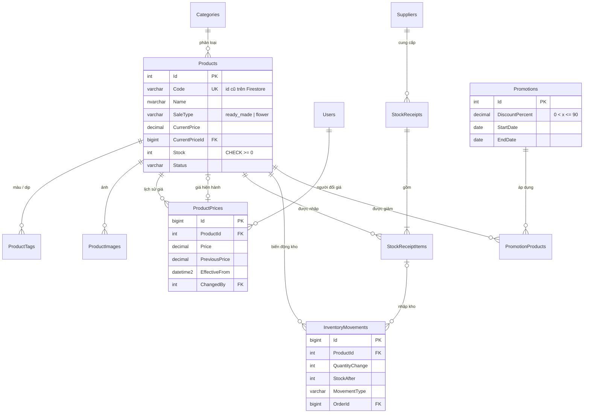
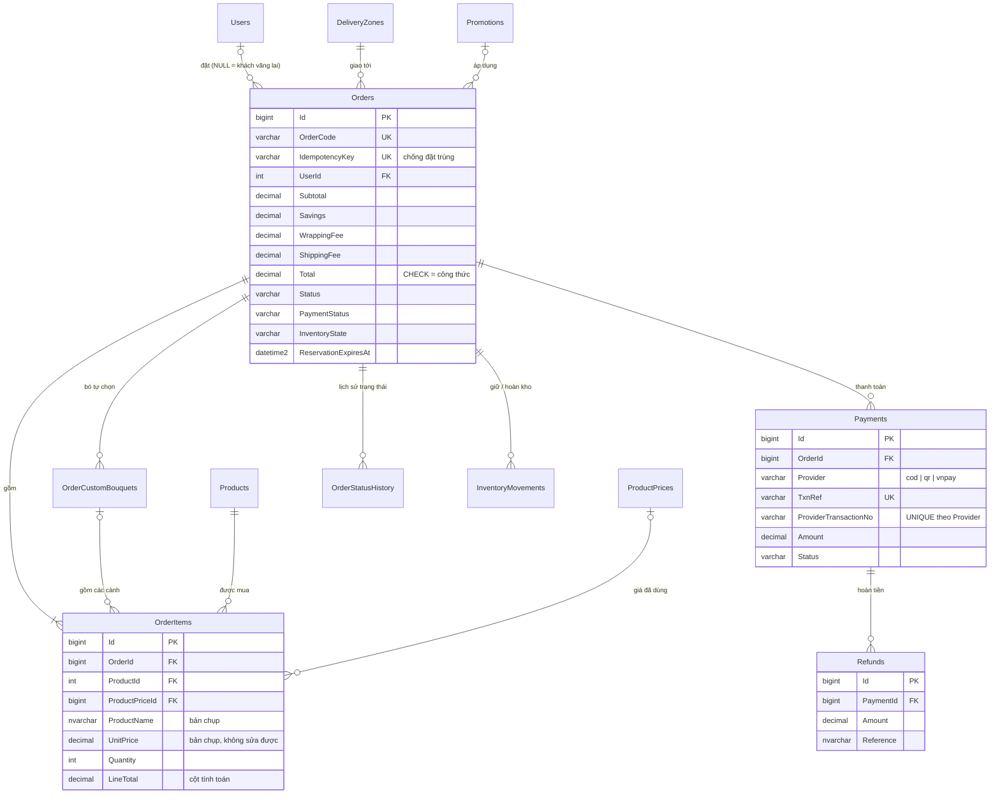
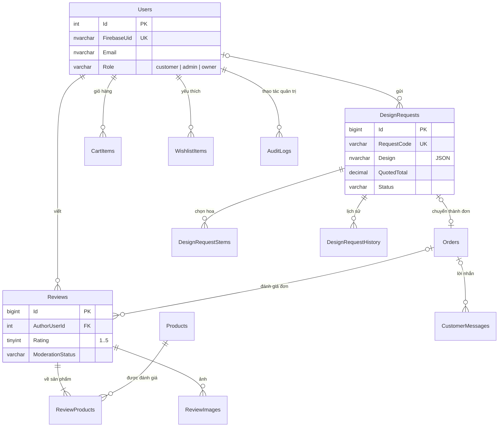
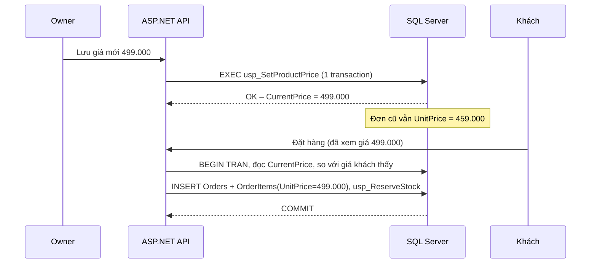

# Thiết kế cơ sở dữ liệu SQL Server – FlowerFlow

> **Trạng thái:** bản đề xuất, chưa dùng trong hệ thống đang chạy. Web hiện tại vẫn dùng Cloud Firestore.
> Tài liệu này phục vụ phương án chuyển dữ liệu nghiệp vụ sang SQL Server (phương án A).

| File | Nội dung |
| --- | --- |
| [`schema.sql`](schema.sql) | Script tạo toàn bộ bảng, ràng buộc, trigger, thủ tục và view |
| [`test-business-rules.sql`](test-business-rules.sql) | 10 kiểm thử quy tắc nghiệp vụ, chạy trên database trống |

## 1. Phạm vi và nguyên tắc chung

- **Phương án A:** dữ liệu nghiệp vụ nằm ở SQL Server; **đăng nhập vẫn dùng Firebase Authentication**. Bảng `Users` liên kết với Firebase qua cột `FirebaseUid`, và **không lưu mật khẩu**.
- **Tiền:** `DECIMAL(18,0)`, đơn vị VND, giá đã gồm VAT. Không dùng `FLOAT` vì sẽ sai số khi cộng tiền.
- **Thời gian:** `DATETIME2(3)` lưu theo **UTC**. Khi báo cáo thì đổi sang giờ Việt Nam (+07:00).
- **Collation đề xuất:** `Vietnamese_CI_AS`. Chuỗi tiếng Việt dùng `NVARCHAR`.
- **Mã trạng thái** lưu bằng chữ tiếng Anh không dấu (`pending`, `paid`…). Giao diện tự đổi sang tiếng Việt (xem mục 7).
- **Quy tắc quan trọng được ép ở tầng database** (CHECK, UNIQUE, trigger), không chỉ dựa vào code API. Như vậy, nếu API có lỗi thì dữ liệu sai cũng không lưu được.

## 2. Sơ đồ quan hệ (ERD)

### 2.1. Sản phẩm, giá, kho và ưu đãi



### 2.2. Đơn hàng, thanh toán và giao hàng



### 2.3. Người dùng, đánh giá, thiết kế riêng, giỏ hàng



## 3. Danh sách bảng theo nhóm

| Nhóm | Bảng | Ghi chú |
| --- | --- | --- |
| Người dùng và phân quyền | `Users`, `AuditLogs` | `Role` thay cho custom claims `admin` và `role: owner`. Claims trên Firebase vẫn giữ để kiểm tra token. |
| Sản phẩm và danh mục | `Categories`, `Products`, `ProductTags`, `ProductImages` | `Products.Code` giữ id cũ (`vn-flower-01`) để chuyển dữ liệu và giữ link cũ |
| Giá và lịch sử giá | `ProductPrices` | Chỉ thêm, không sửa hoặc xóa (trigger `TR_ProductPrices_AppendOnly`) |
| Kho và nhập hàng | `Suppliers`, `StockReceipts`, `StockReceiptItems`, `InventoryMovements` | Mỗi lần kho thay đổi đều có một dòng truy vết |
| Đơn hàng | `Orders`, `OrderItems`, `OrderCustomBouquets`, `OrderStatusHistory` | Đơn lưu bản chụp giá, tên, ưu đãi và phí |
| Thanh toán | `Payments`, `Refunds` | Hỗ trợ nhiều lần thử VNPay và hoàn tiền một phần |
| Đánh giá | `Reviews`, `ReviewProducts`, `ReviewImages`, `CustomerMessages` | Kiểm duyệt `pending` / `approved` / `hidden` |
| Ưu đãi | `Promotions`, `PromotionProducts` | Giới hạn giảm tối đa 90% |
| Giao hàng | `DeliveryZones`, `WrappingFeeTiers` | Phí theo tỉnh/quận; phí gói theo bậc số cành (≤ 50 cành) |
| Thiết kế bó hoa riêng | `DesignRequests`, `DesignRequestStems`, `DesignRequestHistory` | Lựa chọn thiết kế lưu dạng JSON vì danh sách tùy chọn hay thay đổi |
| Giỏ hàng | `CartItems`, `WishlistItems` | Chỉ để tiện cho khách, **không** phải nguồn giá |
| Vận hành | `RateLimitCounters` | Thay cho `orderLookupLimits`, `orderCreationLimits`, `loginProtection` |

## 4. Quy tắc giá: mới có hiệu lực ngay, đơn cũ giữ giá

Đây là nguyên tắc nhóm đã thống nhất và được ép bằng 4 lớp:

1. **Đổi giá chỉ qua `usp_SetProductPrice`.** Trong **một transaction**, thủ tục làm 3 việc: thêm dòng mới vào `ProductPrices`, cập nhật `Products.CurrentPrice` và `CurrentPriceId`, và ghi `AuditLogs`. Commit xong là giá mới có hiệu lực ngay; nếu lỗi thì không có gì thay đổi.
2. **Lịch sử giá bất biến.** Trigger chặn mọi `UPDATE` và `DELETE` trên `ProductPrices`.
3. **Đơn lưu bản chụp.** `OrderItems.UnitPrice` là giá tại lúc đặt, còn `ProductPriceId` cho biết phiên bản giá nào đã được dùng. Khi hiển thị đơn cũ, **không** join sang giá hiện hành.
4. **Giá trong đơn không sửa được.** Trigger `TR_OrderItems_LockPrice` chặn sửa `UnitPrice`, `Quantity`, `DiscountAmount` và `ProductId`.

Luồng tạo đơn vẫn giữ cơ chế hiện tại: khách xem giá → API báo giá → khi đặt, API đọc lại `CurrentPrice` trong transaction. Nếu giá khác số khách đã thấy thì trả lỗi `price-changed`, để khách không bị tính giá mới mà không biết.



## 5. Kho hàng: giữ hàng, hoàn kho, chống bán vượt

- `Products.Stock` có `CHECK (Stock >= 0)`. Kể cả khi API lỗi, kho cũng không thể âm.
- **Giữ hàng** (`usp_ReserveStock`) dùng `UPDATE … WHERE Stock >= @Quantity`, trừ kho và kiểm tra trong cùng một câu lệnh. Hai khách cùng đặt món cuối cùng thì chỉ một người thành công.
- **Hoàn kho** (`usp_ReleaseOrderStock`) chỉ chạy khi `InventoryState = 'reserved'`, nên gọi lại nhiều lần cũng chỉ hoàn kho một lần. Job dọn đơn hết hạn dùng index `IX_Orders_Reservation` để tìm đơn quá `ReservationExpiresAt`.
- **Nhập hàng:** `StockReceipts` và `StockReceiptItems` lưu giá vốn (`UnitCost`), giúp tính lợi nhuận sau này.
- Thời gian giữ hàng giữ như hiện tại trong `api/orders.js`: VNPay 15 phút, COD 30 phút (đơn QR cũ 30 phút).

## 6. Thanh toán và hoàn tiền

- `Payments.TxnRef` là duy nhất. Index `UX_Payments_ProviderTxn` chặn **IPN gửi trùng** (cùng `vnp_TransactionNo` chỉ ghi nhận một lần).
- `UX_Payments_OnePaid`: mỗi đơn có tối đa **một** lần thanh toán thành công.
- `Refunds` cho phép **hoàn một phần và nhiều lần**. Trigger chặn tổng tiền hoàn vượt quá số đã thanh toán, và chặn hoàn tiền cho khoản chưa thanh toán. Đây là cải tiến so với hạn chế hiện tại (chỉ hoàn được toàn bộ đơn).
- `RawResponse` lưu nội dung IPN dạng JSON, **phải che dữ liệu nhạy cảm** trước khi lưu.

## 7. Đối chiếu trạng thái với hệ thống hiện tại

| Hiện tại (Firestore) | SQL Server |
| --- | --- |
| Chờ xác nhận | `pending` |
| Đang chuẩn bị | `preparing` |
| Đang giao | `shipping` |
| Đã giao (cũ: Hoàn thành) | `delivered` |
| Đã hủy | `cancelled` |
| (đơn hết hạn giữ hàng) | `expired` |

| Trạng thái thanh toán hiện tại | SQL Server |
| --- | --- |
| Thanh toán khi nhận hàng | `cod_pending` |
| Chờ xác minh thanh toán / `chua_thanh_toan` | `awaiting` |
| Đã thanh toán / `da_thanh_toan` | `paid` |
| `that_bai` | `failed` |
| Đã hoàn tiền | `refunded` / `partially_refunded` |

| Trạng thái yêu cầu thiết kế | SQL Server |
| --- | --- |
| Chờ tư vấn | `consulting` |
| Chờ báo giá | `quoting` |
| Chờ khách xác nhận | `awaiting_customer` |
| Đang thực hiện | `in_progress` |
| Hoàn thành | `completed` |
| Đã hủy | `cancelled` |

## 8. Đối chiếu collection Firestore → bảng SQL

| Firestore | SQL Server |
| --- | --- |
| `products` | `Products`, `ProductTags`, `ProductImages` |
| `products.priceHistory` | `ProductPrices` |
| `productImages` | `ProductImages` (cột `Data`) |
| `metadata/storeCategories` | `Categories` |
| `metadata/activePromotions` | `Promotions`, `PromotionProducts`, view `vw_ActivePromotions` |
| `metadata/deliveryZones` | `DeliveryZones` |
| `metadata/bouquetWrapping` | `WrappingFeeTiers` |
| `orders` (mảng `items`, `trackingHistory`, `customBouquets`) | `Orders`, `OrderItems`, `OrderStatusHistory`, `OrderCustomBouquets` |
| `orderRequests` (chống đặt trùng) | `Orders.IdempotencyKey`, `Orders.RequestHash` |
| `paymentTransactions` | `Payments` |
| `orderPaymentAudit`, `adminAudit` | `AuditLogs` |
| `reviews`, `reviewImages` | `Reviews`, `ReviewProducts`, `ReviewImages` |
| `messages` | `CustomerMessages` |
| `designRequests` | `DesignRequests`, `DesignRequestStems`, `DesignRequestHistory` |
| `shoppingCarts/{uid}` | `CartItems`, `WishlistItems` |
| `adminRoles` + custom claims | `Users.Role` |
| `orderLookupLimits`, `orderCreationLimits`, `loginProtection` | `RateLimitCounters` |

## 9. Báo cáo

- `vw_DailyRevenue`: doanh thu theo ngày (giờ Việt Nam) của các đơn đã giao, đã trừ tiền hoàn.
- `vw_ActivePromotions`: các ưu đãi đang có hiệu lực hôm nay.

Ví dụ doanh thu tháng 12/2026:

```sql
SELECT SUM(NetRevenue) AS DoanhThuThuan, SUM(OrderCount) AS SoDon
FROM dbo.vw_DailyRevenue
WHERE SalesDate BETWEEN '2026-12-01' AND '2026-12-31';
```

## 10. Cách chạy và kiểm thử

Chạy trên SQL Server 2019+ hoặc Azure SQL. **Không chạy script kiểm thử trên database thật.**

```bash
sqlcmd -S localhost -U sa -C -f 65001 -Q "CREATE DATABASE FlowerFlow COLLATE Vietnamese_CI_AS"
```

```bash
sqlcmd -S localhost -U sa -C -f 65001 -d FlowerFlow -b -i docs/database/schema.sql
```

```bash
sqlcmd -S localhost -U sa -C -f 65001 -d FlowerFlow -b -i docs/database/test-business-rules.sql
```

Kết quả đã chạy trên SQL Server 2022 (Docker, 11/11/2026): tạo được 31 bảng, 3 thủ tục, 3 trigger, 2 view, và **10/10 kiểm thử qua**:

| # | Kiểm thử |
| --- | --- |
| T1 | Owner đổi giá → giá mới hiệu lực ngay, đơn đã đặt giữ giá cũ, lịch sử có 2 dòng |
| T2 | Không sửa được lịch sử giá |
| T3 | Không sửa được giá trong đơn đã tạo |
| T4 | Không cho đặt quá số tồn |
| T5 | Tổng tiền phải đúng công thức tạm tính − giảm + phí gói + phí ship + thuế |
| T6 | Chặn ưu đãi trên 90% |
| T7 | Một giao dịch VNPay chỉ ghi nhận một lần |
| T8 | Hoàn một phần được, không hoàn vượt số đã nhận |
| T9 | Hủy đơn hoàn đúng số lượng, gọi lại không hoàn thêm |
| T10 | Điểm đánh giá chỉ từ 1 đến 5 |

## 11. Câu hỏi còn để nhóm quyết định

1. **Ảnh lưu ở đâu?** Thiết kế cho phép lưu ảnh trong database (`VARBINARY`) giống hiện tại. Khi số ảnh nhiều nên chuyển sang Azure Blob Storage và chỉ lưu `Url`.
2. **Mức giảm tối đa của ưu đãi:** đang đặt 90%. Nhóm có thể đổi con số trong `CK_Promotions_Percent`.
3. **Giỏ hàng khách vãng lai** vẫn lưu `localStorage` như hiện tại. Có cần lưu lên server không?
4. **Giá theo cành (`SaleType = 'flower'`)** dùng chung cơ chế `ProductPrices`. Nếu sau này làm "giá hoa héo tự động" (#107) thì thêm cột `PriceRule` hoặc một bảng riêng.
5. **Xóa sản phẩm:** đề xuất chỉ đổi `Status = 'archived'` (xóa mềm) để không làm hỏng đơn cũ. Bảng `OrderItems` có khóa ngoại tới `Products` nên database sẽ chặn xóa cứng.
