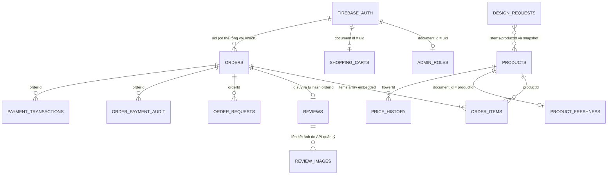

# Mô hình dữ liệu Firestore hiện tại

Đối chiếu ngày **17/11/2026**, source baseline `a1b9bef`. Đây là mô hình logic
của website C#/Firebase, không phải ERD SQL hoặc danh sách dữ liệu đã đọc từ production.
Tên collection lấy từ Domain constants, Application services và `firestore.rules`.

Các cạnh biểu diễn liên kết logic, **không phải foreign key/cascade do Firestore
ép buộc**. `FIREBASE_AUTH` là dịch vụ ngoài Firestore; `ORDER_ITEMS` là phần tử
mảng `orders.items`, không phải collection riêng. ID tham chiếu có thể còn sau
khi sản phẩm bị xóa; snapshot trong đơn giữ giá/tên tại lúc mua.

| Collection/document | Nội dung và liên kết | Truy cập client theo Rules hiện tại |
| --- | --- | --- |
| `products/{id}` | Giá, quantity, saleType, ảnh, phân loại; snapshot khi checkout | Đọc công khai; admin ghi có kiểm tra trường, đổi giá hoa qua Owner API |
| `orders/{id}` | uid, items[], tổng tiền, giao hàng, trạng thái, payment/inventory, hạn giữ kho | Admin hoặc đúng uid đọc; tạo qua API; admin update giới hạn trường/trạng thái, delete cho admin |
| `paymentTransactions/{txnRef}` | orderId, amount, attempt, status, thời hạn và kết quả VNPay. VNPay đã tắt từ 17/11/2026 nên không còn ghi mới; chỉ còn dữ liệu cũ | Không đọc/ghi trực tiếp |
| `orderRequests/{key}` | orderId, requestHash, uid; chống tạo đơn trùng | Chỉ backend; không phải mã tra cứu công khai |
| `orderPaymentAudit/{id}` | Nhật ký đối soát/hoàn tiền của đơn | Chỉ backend; API admin lọc dữ liệu |
| `reviews/{id}` | id = 40 ký tự đầu SHA256("review:" + orderId); authorUid, productIds, photoIds, moderationStatus, reply; orderId được suy ra ở API, không ghi như field khi tạo | Công khai chỉ approved; tác giả/admin có quyền đọc thêm; tạo qua API, admin sửa trường cho phép |
| `reviewImages/{id}`, `productImages/{id}` | Bytes/metadata ảnh do API quản lý | Client trực tiếp bị từ chối; API quyết định quyền đọc/tải lên |
| `shoppingCarts/{uid}` | cart[], wish[], mỗi danh sách tối đa 100 dòng; không authoritative về giá/kho | Chỉ chủ uid get/write/delete, không list |
| `designRequests/{id}` | uid tùy chọn, thông tin giao, stems/snapshot, báo giá, accessTokenHash | Qua API; token truy cập khách không lưu dạng rõ |
| `priceHistory/{id}` | flowerId và lịch sử thay đổi giá | Qua API Owner; cập nhật cùng transaction giá |
| `productFreshness/{productId}` | Dữ liệu ngày nhập cho giá héo | Qua API; client trực tiếp bị từ chối |
| `metadata/activePromotions`, `metadata/storeCategories` | Danh sách ưu đãi và phân loại | Get công khai; admin quản lý theo Rules |
| `metadata/productCatalog` | Trạng thái catalog | Admin |
| `metadata/deliveryZones`, `metadata/bouquetWrapping` | Khu vực/phí giao và bậc phí bó | API đọc cấu hình; admin cập nhật có validation/audit; Rules metadata cũng cho admin ghi, không phải API-only |
| `metadata/wiltingPricing` | Quy tắc giá héo | Owner API; Rules chặn ghi trực tiếp document này |
| `adminRoles/{uid}` | Quyền quản trị còn hiệu lực | Backend; API/Rules dùng cùng custom claim để kiểm tra quyền |
| `adminAudit/{id}` | Actor, action, entity và details của thao tác qua API | Backend/API admin, không truy cập trực tiếp |
| `orderLookupLimits`, `orderCreationLimits`, `loginProtection` | Bộ đếm giới hạn theo khóa/hash và thời gian | Backend; không đưa khóa giới hạn ra frontend |
| `messages/{id}` | Lời nhắn cũ được admin đồng bộ | Admin đọc/ghi |

“Chỉ backend” trong bảng có nghĩa chỉ truy cập từ backend đáng tin cậy, không phải
quyền mà client tự khai báo. Admin SDK bỏ qua Firestore Rules, nên API vẫn phải
xác thực, phân quyền và validate riêng. Collection không có match cụ thể bị default deny.

## Nhất quán và dữ liệu nhạy cảm

- Checkout đọc lại giá/ưu đãi/phí giao và giữ quantity cùng transaction tạo đơn và
  idempotency record. Đổi giá về sau không sửa snapshot đơn cũ.
- Inventory có vòng đời reserved/sold/released. Hạn giữ (`reservationExpiresAt`): COD
  5 phút, QR 30 phút. Hết hạn/hủy và xác nhận tiền cạnh tranh cần transaction và kiểm
  tra trạng thái để không trả kho hoặc ghi nhận thanh toán lặp.
- Composite index (`flower.com/firestore.indexes.json`, đã tạo trên production
  17/11/2026): `orders(inventoryReserved, reservationExpiresAt)` cho dọn đơn hết hạn,
  `orders(uid, createdAt)` cho đơn của tôi, `reviews(moderationStatus, productIds)`,
  `orderPaymentAudit(orderId, createdAt)`. Thiếu index thì API tương ứng trả 503.
- Giá héo đọc `metadata/wiltingPricing` và `productFreshness`; mặc định tắt.
- PII đơn hàng, audit, token hash và bộ đếm không công khai. Firebase quản lý tài khoản
  production; SQLite local chỉ dùng Development, không phải collection Firestore.
- Backup đệ quy cả subcollection và con dưới cha đã xóa, trừ cây root
  `orderLookupLimits`; mã hóa AES-256-GCM, restore tạo/ghi đè nhưng không xóa document
  ngoài archive. Không bao gồm Firebase Auth, Storage, Rules/indexes/IAM/secret.
  Xem [runbook backup](https://github.com/Longg5048/flower.com/blob/main/docs/BACKUP-RESTORE.md).

## Các mô hình khác

[Thiết kế SQL Server](https://github.com/Longg5048/flower.com/blob/main/docs/database/DATABASE-DESIGN.md)
là đề xuất chưa triển khai. Host `FlowerFlow.Backend` dùng InMemory và hợp đồng
`/api/v1`, chưa thay schema/host production. Không chạy `schema.sql` hoặc migration
để “đồng bộ” sơ đồ này. Mọi chuyển dữ liệu cần kế hoạch riêng, backup và rollback.
