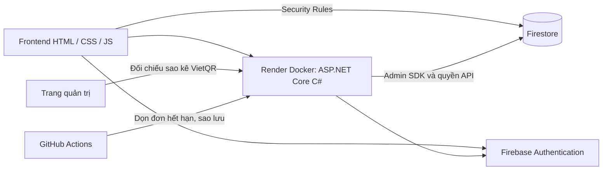
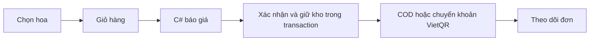
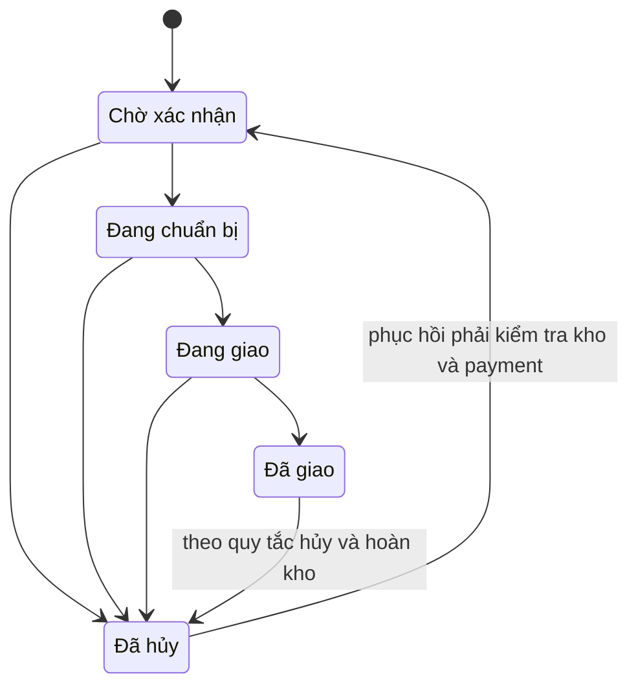

# 🌸 FlowerFlow

**Website bán hoa tươi trực tuyến kèm hệ thống quản lý cửa hàng**

[Yêu cầu chức năng](Functional-Requirements.md) · [Yêu cầu phi chức năng](Non-Functional-Requirements.md) · [Kiến trúc phần mềm](Software-Architecture-Document.md)

---

## 📌 Tầm nhìn sản phẩm

FlowerFlow giúp khách hàng **tìm, chọn và đặt hoa trong vài phút**, đồng thời giúp chủ cửa hàng **quản lý sản phẩm, tồn kho, đơn hàng và doanh thu** ở cùng một nơi.

| 🛍️ Khách hàng | 🧑‍💼 Nhân viên quản lý | 👑 Chủ cửa hàng |
| --- | --- | --- |
| Tìm và lọc hoa theo loài, dịp, màu, giá | Xác nhận và cập nhật trạng thái đơn | Toàn quyền nhân viên quản lý |
| Tùy chọn bó hoa, thiệp, gói quà | Quản lý sản phẩm, tồn kho, danh mục | Cấp và thu hồi quyền quản lý |
| Thanh toán COD hoặc chuyển khoản VietQR | Duyệt đánh giá, trả lời lời nhắn | Xuất báo cáo doanh thu ra Excel |
| Theo dõi đơn, đánh giá kèm ảnh | Theo dõi thanh toán, xem báo cáo doanh thu | |

## 🎯 Mục tiêu chính

1. **Mua hoa nhanh và thuận tiện**: từ lúc chọn hoa đến khi đặt xong chỉ qua 3 bước (giỏ hàng → thanh toán → xác nhận).
2. **Không bán vượt tồn kho**: kho được giữ chỗ ngay khi đặt đơn và tự trả lại nếu đơn quá hạn.
3. **Giá và thanh toán chính xác**: mọi khoản tiền đều do máy chủ tính lại, không tin số liệu từ trình duyệt.
4. **Giảm thao tác thủ công** cho cửa hàng nhờ trang quản trị và báo cáo tự động.

## 🏗️ Kiến trúc tổng quan

Cập nhật 18/11/2026: `FlowerFlow.Api` là backend chính, website tại <https://flower-com.onrender.com>; VNPay đã tắt từ 17/11/2026, thanh toán online chỉ còn chuyển khoản VietQR do cửa hàng xác nhận; Node legacy chỉ để đối chiếu, backend độc lập InMemory chưa thay production. [SAD](Software-Architecture-Document.md) · [Mô hình dữ liệu](Data-Model.md).

## 🛒 Luồng mua hàng

## 📦 Vòng đời đơn hàng

Sơ đồ là trạng thái chuẩn; quyền chuyển, điều kiện thanh toán và reserved/sold/released
được kiểm tra riêng trong API/Rules, không phải mọi caller đều thực hiện được mọi cạnh.

> ⏱️ **Thời gian giữ hàng:** COD 5 phút chờ cửa hàng xác nhận · chuyển khoản QR 30 phút chờ tiền về. Quá hạn, đơn tự hủy và hàng trả lại kho ở lần dọn đơn kế tiếp (khi có báo giá/đặt hàng, admin mở dashboard hoặc lịch GitHub Actions).
>
> 🚚 **Giao hàng:** chỉ nội thành Hà Nội (12 quận), 5.000 VND/km tính từ cửa hàng ở Hà Đông.

## 🧭 Phạm vi

| Hạng mục | Nội dung |
| --- | --- |
| **Người dùng** | Khách mua hoa, nhân viên quản lý, chủ cửa hàng |
| **Nền tảng** | Website (máy tính và điện thoại) + trang quản trị |
| **Chức năng cốt lõi** | Danh mục và tìm kiếm, giỏ hàng, đặt hàng, thanh toán COD/VietQR, giao nội thành Hà Nội, theo dõi đơn, đánh giá |
| **Quản trị** | Sản phẩm, tồn kho, danh mục, ưu đãi, khu vực giao, đơn hàng, doanh thu, người dùng |
| **Ngoài phạm vi** | Nhiều chi nhánh, ứng dụng di động riêng, thanh toán thẻ tín dụng trực tiếp |

## 📚 Tài liệu liên quan

| Trang | Nội dung |
| --- | --- |
| 📋 [Yêu cầu chức năng](Functional-Requirements.md) | Danh sách chức năng cho khách hàng và quản trị |
| ⚡ [Yêu cầu phi chức năng](Non-Functional-Requirements.md) | Hiệu năng, bảo mật, sao lưu, kiểm thử |
| 🏛️ [Kiến trúc phần mềm](Software-Architecture-Document.md) | Thành phần hệ thống, dữ liệu, triển khai |
| 🗄️ [Mô hình dữ liệu](Data-Model.md) | Firestore hiện tại và ranh giới với SQL đề xuất |
| 🔗 [Ma trận truy vết](Traceability-Matrix.md) | Mỗi yêu cầu nối tới issue, Pull Request và test |
| 🗂️ [Project charter](https://github.com/Longg5048/flower.com/blob/main/docs/product/PROJECT-CHARTER.md) | Mục tiêu, phạm vi, phân công, Definition of Done, rủi ro |
| 👥 [Persona](https://github.com/Longg5048/flower.com/blob/main/docs/product/PERSONAS.md) | Persona hiện là giả định, chưa được xác minh bằng nghiên cứu thật |
| 🔎 [Kế hoạch nghiên cứu người dùng](https://github.com/Longg5048/flower.com/blob/main/docs/product/USER-RESEARCH-PLAN.md) | Cách thực hiện phỏng vấn và usability test; chưa có kết quả nghiên cứu |
