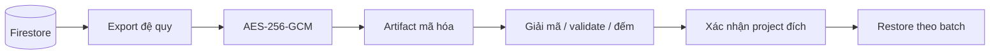

# ⚡ Yêu cầu phi chức năng

**Hệ thống phải chạy ổn định, nhanh, an toàn và dễ sửa đến mức nào**

[🏠 Trang chủ](Home.md) · [📋 Yêu cầu chức năng](Functional-Requirements.md) · [🏛️ Kiến trúc phần mềm](Software-Architecture-Document.md)

---

Mỗi yêu cầu có cột **Hiện trạng** cho biết hệ thống hiện tại đã đáp ứng tới đâu:
✅ Đạt · ⚠️ Đạt một phần · ❌ Chưa đạt

Xem [ma trận truy vết KH/QT/NF](Traceability-Matrix.md) để biết test nào thực sự kiểm tra từng chỉ tiêu và những bằng chứng còn thiếu. Test chức năng/CI xanh không tự chứng minh các ngưỡng uptime, tải hoặc độ trễ trong bảng dưới.

## 🟢 Sẵn sàng và tin cậy

| Mã | Yêu cầu | Chỉ tiêu | Hiện trạng |
| --- | --- | --- | --- |
| NF‑01 | Hoạt động liên tục | Chạy 24/7, uptime ≥ 99,9% | ⚠️ Render Free và Firebase; không cam kết uptime 99,9%; chưa có công cụ đo uptime |
| NF‑02 | Chịu tải dịp lễ | Ổn định khi lượng truy cập tăng 10–20 lần (14/2, 8/3, 20/10) | ⚠️ Load test trên emulator: đọc/báo giá > 700 yêu cầu/giây, p95 < 45 ms; nhưng ≥ 100 khách cùng mua một sản phẩm có thể bị lỗi 503 dù còn hàng ([báo cáo](https://github.com/Longg5048/flower.com/blob/main/docs/test-reports/2026-11-11-load-test.md)) |
| NF‑03 | Sao lưu tự động | Sao lưu dữ liệu mỗi ngày | ⚠️ Đã cấu hình secret; chạy thật thành công 17/11/2026 ([run 44018473975](https://github.com/Longg5048/flower.com/actions/runs/44018473975), 200 document, file mã hóa). Lịch 01:23 hằng ngày bị GitHub trì hoãn; chưa đủ 24 giờ bằng chứng chạy theo lịch (#118) |
| NF‑04 | Khôi phục dữ liệu | Khôi phục được từ bản sao lưu | ⚠️ Diễn tập emulator/CLI/Node-C# (#165); bản backup production 17/11 giải mã và xem trước khớp số document. Chưa restore thật vào project, chưa đo RPO/RTO |

Workflow production đã chạy thành công lần đầu ngày 17/11/2026 (sao lưu + xem trước khôi phục, không ghi Firestore). [Runbook](https://github.com/Longg5048/flower.com/blob/main/docs/BACKUP-RESTORE.md).

## 🚀 Hiệu năng

| Mã | Yêu cầu | Chỉ tiêu | Hiện trạng |
| --- | --- | --- | --- |
| NF‑05 | Tải trang chọn hoa | ≤ 5 giây | ✅ Lighthouse Mobile trên Render 17/11/2026: `/product.html` LCP 3,9 s, Performance 86, Accessibility 96, Best Practices 100, SEO 100 ([báo cáo](https://github.com/Longg5048/flower.com/blob/main/docs/issue-119-deployment.md)). Chưa đạt mốc Performance ≥ 90; lần mở đầu khi Render Free đang ngủ chậm hơn |
| NF‑06 | Xử lý thanh toán | ≤ 5 giây, không tính thời gian chờ ngân hàng | ⚠️ Không còn cổng thanh toán (VNPay tắt 17/11/2026); tạo đơn COD/QR trên Render phản hồi trong vài giây khi instance đang thức, chưa đo có hệ thống |
| NF‑07 | Đồng bộ tồn kho | Website và trang quản trị cập nhật trong ≤ 10 giây | ⚠️ Có đồng bộ Firestore; chưa đo ngưỡng 10 giây trên production |
| NF‑08 | Không bán vượt kho | An toàn khi nhiều người mua cùng lúc | ✅ Kiểm tra và trừ kho trong cùng một giao dịch; có test |

## 🔒 Bảo mật

| Mã | Yêu cầu | Chỉ tiêu | Hiện trạng |
| --- | --- | --- | --- |
| NF‑09 | Thanh toán an toàn | Không lưu thông tin thẻ; kết quả thanh toán phải xác thực được | ✅ Website không nhận thông tin thẻ. Chuyển khoản VietQR chỉ được ghi nhận khi admin đối chiếu sao kê và xác nhận qua API, có audit `orderPaymentAudit`. Mã VNPay (HMAC-SHA512) đã tắt |
| NF‑10 | Giá không bị sửa | Tiền hàng do máy chủ tính | ✅ Máy chủ tính lại giá, ưu đãi, phí giao trước khi tạo đơn |
| NF‑11 | Mật khẩu mạnh | Mật khẩu mới có 8–4096 ký tự, chữ thường (a–z) và số (0–9) | ✅ Form, API local và Firebase Password Policy (Require) trên production. Gọi thẳng Firebase signUp với 4 mật khẩu yếu đều bị từ chối `PASSWORD_DOES_NOT_MEET_REQUIREMENTS` (#121, 17/11/2026) |
| NF‑12 | Phân quyền | Khách, quản lý, chủ cửa hàng chỉ làm được việc của mình | ✅ Kiểm tra ở máy chủ và Firestore Rules; có test |
| NF‑13 | Thao tác nhạy cảm | Chỉ chủ cửa hàng được cấp quyền và giảm giá lớn | ⚠️ Chỉ chủ cấp quyền; nhưng quản lý vẫn tạo được ưu đãi tới 100% |

## 🛠️ Bảo trì

### Chính sách mật khẩu và đánh giá MFA — issue #121 (11/11/2026)

Form đăng ký và đặt lại mật khẩu local dùng cùng chính sách với máy chủ local; đăng nhập vẫn chấp nhận mật khẩu cũ. Không thay thuật toán băm của tài khoản local và không tự băm mật khẩu Firebase. Trang đặt lại mật khẩu Firebase dùng email dẫn tới giao diện do Firebase quản lý, nên phải bật chính sách ở dịch vụ để chống bỏ qua kiểm tra trình duyệt.

Chủ repo cần vào Firebase Console → Authentication → Settings → Password policy: chọn **Require**, minimum length **8**, maximum **4096**, **Lowercase character required** và **Numeric character required**. Không bật force upgrade on sign-in để tránh khóa luồng đăng nhập cũ. Chữ hoa/ký tự đặc biệt được khuyến khích nhưng chưa bắt buộc. **Đã bật trên project `web-ban-hoa-9fe0b` ngày 17/11/2026** (trước đó: Notify, tối thiểu 6) và kiểm tra bằng cách gọi thẳng Firebase signUp bỏ qua form: `abcdefgh`, `abc1234`, `12345678`, `ABCDEFG1` đều bị từ chối, không tạo tài khoản. Xem [hướng dẫn chính thức](https://firebase.google.com/docs/auth/web/password-auth).

Kết luận MFA: đề xuất TOTP cho admin/owner sau khi nâng Firebase Authentication lên Identity Platform và xác nhận chi phí/hạn mức phù hợp. [Firebase yêu cầu email đã xác minh và luồng đăng ký/xác thực yếu tố thứ hai](https://firebase.google.com/docs/auth/web/totp-mfa). PIN và câu hỏi khôi phục local hiện có không phải MFA của Firebase.

Chưa bật MFA trong issue này. Luồng đăng nhập mật khẩu hiện đi qua API máy chủ rồi tạo custom token; custom auth tokens không hỗ trợ MFA theo tài liệu Firebase, nên không thể chỉ bật công tắc rồi coi admin đã được bảo vệ. Cần thiết kế lại luồng admin để xử lý thử thách MFA, kiểm tra yếu tố thứ hai ở máy chủ trước khi cấp quyền, đăng ký thiết bị và quy trình khôi phục khi mất thiết bị. Trước triển khai cần test admin/owner thiếu yếu tố hai bị từ chối, TOTP sai/hết hạn, mất thiết bị và tài khoản khách không bị ảnh hưởng. Việc nâng dịch vụ và triển khai MFA thuộc thay đổi riêng sau khi chủ repo duyệt phương án.

| Mã | Yêu cầu | Chỉ tiêu | Hiện trạng |
| --- | --- | --- | --- |
| NF‑14 | Dễ bảo trì | Code chia module, có quy ước và tài liệu | ⚠️ Có module, README, SAD và kiểm tra ranh giới backend (#166/#167); khả năng bảo trì vẫn cần review |
| NF‑15 | Kiểm thử tự động | Mỗi thay đổi đều chạy test | ✅ CI tách native C#, Node legacy/frontend và backend độc lập; số lượng/kết quả lấy theo commit trong ma trận |

## ✅ Tiêu chí nghiệm thu

| Kiểm thử | Hiện trạng |
| --- | --- |
| Khôi phục dữ liệu từ bản sao lưu | ✅ Test tự động trên emulator |
| Tải tăng 10–20 lần | ⚠️ Có kịch bản `cd flower.com/tests && npm run load` trên emulator; phát hiện lỗi khi nhiều người cùng mua một sản phẩm |
| Đo thời gian tải trang và thanh toán | ⚠️ Lighthouse production đã đo (17/11/2026); thời gian xử lý đơn chưa đo có hệ thống |
| Nhiều người cùng mua sản phẩm cuối cùng | ✅ Không bán vượt kho với 5–200 người cùng mua (load test); ⚠️ có thể báo lỗi 503 oan khi ≥ 100 người |
| Quyền của khách, quản lý, chủ cửa hàng | ✅ Có test tự động |
