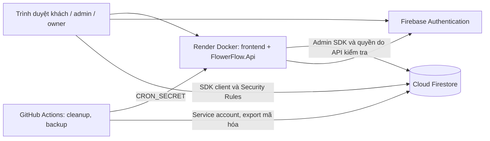
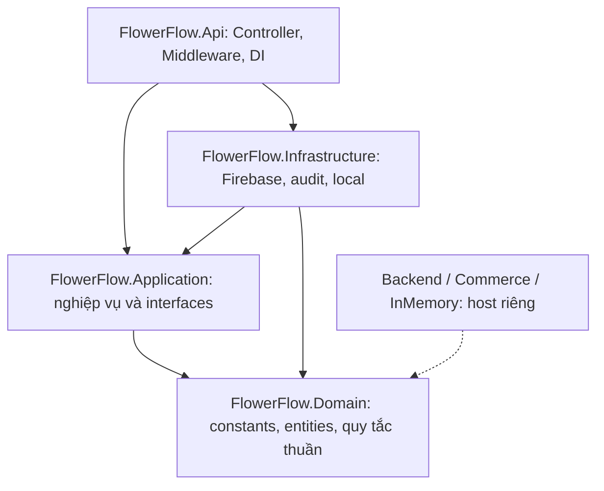
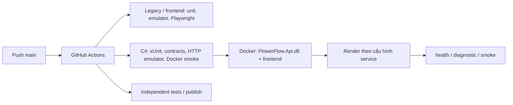

# Kiến trúc phần mềm — FlowerFlow

Đối chiếu **17/11/2026**, baseline source `a1b9bef`. Mô tả mã/cấu hình trên main,
không xác nhận mọi thiết lập dashboard hoặc dịch vụ production đã được kiểm tra.

[Trang chủ](Home.md) · [Mô hình dữ liệu](Data-Model.md) · [Ma trận bằng chứng](Traceability-Matrix.md)

## 1. Phạm vi và quyết định kiến trúc

Website dùng HTML/CSS/JavaScript thuần, ASP.NET Core .NET 10 và Firebase.
Render/Docker phục vụ frontend cùng `/api/...` trên một origin. Node 24 chỉ dùng
công cụ/test/launcher local; nguồn `legacy-node` giữ làm baseline đối chiếu.
`FlowerFlow.Backend` là host độc lập InMemory, development identity, payment
simulator và `/api/v1`, chưa thay website. SQL Server mới là đề xuất, chưa kết nối/migrate.



Frontend còn truy cập Firestore trực tiếp ở catalog, shopping snapshot và một số
thao tác admin. Rules phải triển khai riêng; Admin SDK bỏ qua Rules nên API vẫn
phải kiểm tra quyền và dữ liệu. Firebase Auth quản lý tài khoản production;
cache/giỏ ngoại tuyến còn trong trình duyệt, local auth dùng SQLite.

## 2. Thành phần và phụ thuộc



| Thành phần | Trách nhiệm |
| --- | --- |
| Api | `/api/...`, static frontend, CSP/headers, origin/body limits và local identity |
| Application | Accounts/Admin/Catalog/Orders/Payments/DesignRequests/ShopSettings; giá, quyền, trạng thái và transaction |
| Infrastructure | Firebase Admin/Firestore, audit, SQLite/scrypt và HTTP helpers (mã ký VNPay còn nhưng endpoint đã tắt) |
| Domain | Tên collection, trạng thái, tiền/lịch/giá héo và khu vực Hà Nội |
| Frontend | Hiển thị, cache/giỏ tạm, Firebase Web SDK; không quyết định giá/kho/thanh toán |

`npm run dev` tải `.env`, khởi động C# Development cổng 3000. `dotnet run --project
flower.com/backend/FlowerFlow.Api` dùng launch profile (5080), không tự tải `.env`.
Production dùng Firebase auth; local auth chỉ bật Development và loopback. Xem
[ranh giới backend](https://github.com/Longg5048/flower.com/blob/main/flower.com/docs/backend/BACKEND-BOUNDARIES.md).

## 3. Dữ liệu và luồng nghiệp vụ

[Data-Model](Data-Model.md) có sơ đồ và bảng quyền từng collection. Các liên kết là
logic trong code, không phải khóa ngoại/cascade SQL; dòng sản phẩm trong đơn là snapshot.

```mermaid
sequenceDiagram
    participant C as Trình duyệt
    participant A as C# API
    participant F as Firestore
    C->>A: Báo giá (productId, quantity, khu vực)
    A->>F: Đọc giá / kho / ưu đãi / phí
    A-->>C: Tổng do server tính
    C->>A: Xác nhận + idempotency key
    A->>F: Transaction: đọc lại, giữ kho, tạo order + request record
    A-->>C: Mã đơn và thông tin thanh toán (COD hoặc mã VietQR)
    opt Chuyển khoản QR
        C->>C: Khách chuyển khoản theo QR, đúng số tiền và nội dung
        Note over A,F: Admin đối chiếu sao kê ngân hàng
        A->>F: Transaction: kiểm tra quyền admin, số tiền, trạng thái; ghi orderPaymentAudit
    end
```

Không có cổng thanh toán tự xác nhận: VNPay đã tắt từ 17/11/2026 (`/api/payments`,
`/api/vnpay-ipn` trả 410). Giữ kho: COD 5 phút chờ cửa hàng xác nhận, QR 30 phút chờ
chuyển khoản (`OrderConfig.cs`). Đơn hết hạn được hủy và hoàn kho một lần ở lần dọn
kế tiếp: khi báo giá/đặt hàng, admin mở dashboard, worker C# lúc instance thức hoặc
GitHub Actions (lịch 15 phút nhưng thực tế chỉ vài lần mỗi ngày). Truy vấn dọn đơn
cần composite index `orders(inventoryReserved, reservationExpiresAt)`. Giao thành
công chốt sold. Chuyển trạng thái phải phù hợp payment/inventory, không chỉ nhãn UI.

Khi chưa lưu khu vực riêng, C# cung cấp khu vực nội thành Hà Nội từ Hà Đông,
5.000 VND/km theo khoảng cách định sẵn, không gọi routing/GPS để đo địa chỉ thật.
Danh sách admin đã lưu được ưu tiên. Nguồn: `HanoiDeliveryZones.cs`, `DeliveryZonesService.cs`.

## 4. Bảo mật

- Firebase ID token kiểm tra cả thu hồi; admin cần claim và live `adminRoles`, Owner
  cấp/gỡ quyền qua API. Ẩn nút UI không thay phân quyền.
- Giá/kho/tổng tiền được server đọc lại. Idempotency không thay transaction.
- PII đơn được lọc khi tra cứu công khai; token thiết kế chỉ lưu hash.
- CSP, headers, Origin và proxy tin cậy bảo vệ host; không tin forwarded header tùy ý.
- Service account/cron/backup secrets ở Render/GitHub, không trong Git/frontend.
  Firebase Web config công khai không phải service account.
- SQLite Development lưu mật khẩu/PIN/câu trả lời băm scrypt, không dùng cho production.
  Firebase Password Policy đã bật Require (≥ 8 ký tự, chữ thường, số) ngày 17/11/2026;
  MFA cho admin mới được đánh giá, chưa bật.

## 5. Triển khai, vận hành, rollback



`render.yaml`: main, Dockerfile `flower.com/backend/Dockerfile`, `/health`, checksPass.
Dashboard service đang đặt Auto-Deploy "After CI Checks Pass" cho `main`; một check đỏ
trên commit chặn bản đó lên production. Dashboard phải khớp file này; CI xanh không chứng minh deployment hoặc Firebase đã
kết nối. `/health` chỉ liveness; không có endpoint readiness kiểm tra Firebase riêng.
Diagnostic `--check-firebase` là lệnh read-only chạy riêng với credential đúng project theo
[runbook](https://github.com/Longg5048/flower.com/blob/main/flower.com/docs/backend/DEPLOYMENT.md).
Runtime image không cần Node. Domain Vercel cũ chuyển hướng Render; không cam kết
Vercel preview cho C# PR. Worker C# dọn đơn và GitHub scheduler gọi API có CRON_SECRET.

Backup mã hóa export Firestore, restore preview và lưu artifact. Secret đã cấu hình;
lần chạy production đầu tiên thành công 17/11/2026 (200 document, xem trước khôi phục
khớp số liệu), còn chờ bằng chứng chạy theo lịch (#118). Emulator đã diễn tập restore; export không phải snapshot toàn DB, restore atomic theo batch.
Không backup Auth/Storage/Rules/indexes/IAM/secrets. Xem
[runbook backup](https://github.com/Longg5048/flower.com/blob/main/docs/BACKUP-RESTORE.md).

Rollback bằng image/commit C# đã xác minh, không chuyển sang Node cũ hoặc InMemory.
Thay schema tương lai cần backup, kế hoạch chuyển riêng và đối soát đơn/thanh toán/kho.

## 6. Bằng chứng và giới hạn

Baseline `a1b9bef`: 93 xUnit (35 native + 58 independent), contracts local và ba
workflow CI thành công; xem [mốc FF-11](Traceability-Matrix.md). Emulator/fixture/
simulator không thay provider/production. Render Free không đồng nghĩa uptime 99,9%;
tải/latency production, RPO/RTO và backup theo lịch còn cần đo/xác minh. Lighthouse
production đã đo 17/11/2026 (Performance 86, LCP trang sản phẩm 3,9 s).
