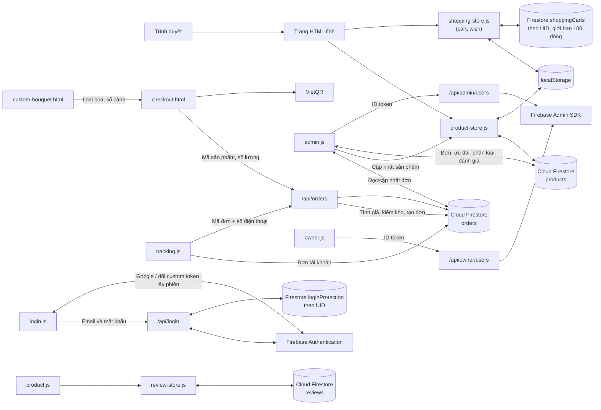

# FlowerFlow: Kiến trúc kỹ thuật

Tài liệu này mô tả kiến trúc, luồng dữ liệu và các module chính của website. Hướng dẫn cài đặt và tổng quan dự án nằm ở [README gốc](../README.md).

## Tổng quan

FlowerFlow là ứng dụng frontend tĩnh (HTML, CSS, JavaScript thuần, không có bước build) kết hợp với:

- **Firebase Authentication** để đăng nhập khách hàng và quản trị viên.
- **Cloud Firestore** để lưu catalog, đánh giá và đơn hàng dùng chung giữa các thiết bị.
- **Vercel Functions** (`api/`) để chạy các thao tác cần Firebase Admin SDK.
- **`localStorage`** để cache catalog, duy trì giỏ hàng cục bộ và làm bản lưu ngoại tuyến.

## Các module chính

> File JavaScript nằm trong `js/<nhóm>/`, CSS trong `css/<nhóm>/` (nhóm: `core`, `catalog`, `order`, `review`, `account`, `admin`). Ví dụ `product-store.js` ở `js/catalog/product-store.js`.

| Khu vực | Tệp | Trách nhiệm |
| --- | --- | --- |
| Header và footer | `store-header.js/.css`, `store-footer.js/.css` | Chèn header (tìm kiếm, tài khoản, yêu thích, đơn hàng, giỏ hàng, menu mobile) và footer cho các trang cửa hàng |
| Trang chủ | `index.html`, `homepage.css` | Giới thiệu, danh mục nổi bật, điều hướng |
| Catalog | `product-store.js`, `flower.json` | Đồng bộ catalog do cửa hàng quản lý với Firestore, cache vào `localStorage`, lắng nghe thay đổi theo thời gian thực; không tự nạp sản phẩm mẫu |
| Tự phối bó | `custom-bouquet.html`, `custom-bouquet.js` | Chọn loại hoa, số lượng, màu mong muốn, vai trò hoa chính/phụ, bố cục và kiểu gói; xem dự toán, lưu bản nháp hoặc gửi yêu cầu tư vấn |
| Yêu cầu thiết kế riêng | `design-request.html`, `api/design-requests.js` | Lưu yêu cầu vào Firestore, theo dõi lịch sử, nhận báo giá cửa hàng và chấp nhận/từ chối bằng mã truy cập riêng |
| Danh mục và chi tiết | `product.html`, `product.js`, `product-categories.js`, `related-products.js` | Tìm kiếm, lọc, sắp xếp; trang chi tiết, thư viện ảnh, gợi ý sản phẩm liên quan |
| Đánh giá | `review-store.js` | Đọc đánh giá công khai và gửi đánh giá mới (yêu cầu đăng nhập) lên Firestore |
| Giỏ hàng và yêu thích | `shopping-store.js`, `shopping-sync.js`, `cart.html`, `wish.html` | Lưu ngoại tuyến, đồng bộ Firestore theo UID khi đăng nhập; giá/tồn kho vẫn do API đặt hàng xác minh |
| Thanh toán | `checkout.html`, `placeorder.html` | Người gửi/người nhận, lịch giao giờ Việt Nam, khu vực và phí giao do máy chủ báo giá, ưu đãi, QR, tạo đơn |
| Theo dõi đơn | `tracking.html`, `tracking.js`, `order-status.js` | Tra cứu công khai giới hạn thông tin; đơn tài khoản hiển thị chi tiết người gửi/nhận và phí |
| Tài khoản | `login.*`, `account.*`, `forgot-password.*` | Đăng ký, đăng nhập, khôi phục mật khẩu, hồ sơ |
| Tiền tệ | `currency.js` | Định dạng giá VND; mọi giá lưu là số nguyên VND (ví dụ `450000`) |
| Liên hệ | `contact-tools.js/.css` | Thanh liên hệ Facebook và Zalo (ẩn trên trang quản trị) |
| Quản trị | `admin.html`, `admin.js`, `admin.css` | Sản phẩm, danh mục, ưu đãi, cấu hình khu vực/phí giao và bậc phí gói bó hoa, xử lý yêu cầu thiết kế/báo giá, đơn hàng, xác minh QR và xem audit đối soát, doanh thu, đánh giá, lời nhắn, người dùng |
| Owner | `owner.html`, `owner.js`, mục “Quản lý giá hoa” trong `admin.html` | Cấp/gỡ quyền admin; cập nhật giá hoa nguyên liệu và xem lịch sử giá |
| API | `api/admin/users.js`, `api/owner/users.js`, `api/flower-prices.js`, `api/delivery-zones.js`, `api/bouquet-wrapping.js`, `api/design-requests.js`, `api/orders.js`, `lib/firebase-admin.js` | API giá hoa chỉ Owner dùng, cập nhật giá và lịch sử trong cùng giao dịch; quản lý khu vực/phí bó, yêu cầu thiết kế; báo giá/tạo đơn authoritative, tra cứu đơn khách và đối soát thanh toán |

## Dữ liệu

### Nơi lưu trữ

| Dữ liệu | Nơi lưu | Đồng bộ giữa thiết bị |
| --- | --- | :---: |
| Hoa nguyên liệu và bó làm sẵn | Firestore `products`, cache `localStorage.flowerInventory` | ✅ |
| Trạng thái khởi tạo catalog | Firestore `metadata/productCatalog` | ✅ |
| Đánh giá trên trang sản phẩm | Firestore `reviews` | ✅ |
| Tài khoản Firebase, vai trò | Firebase Authentication (custom claims) | ✅ |
| Giỏ hàng, yêu thích | `localStorage` (bản cục bộ) và Firestore `shoppingCarts/{uid}` (tài khoản đăng nhập) | ✅ với tài khoản |
| Đơn hàng mới | `/api/orders` xác minh giá/tồn kho rồi ghi Firestore `orders`; mỗi dòng lưu giá và đơn vị tại thời điểm đặt | ✅ |
| Giá hoa nguyên liệu | Firestore `products`; Owner cập nhật qua `/api/flower-prices`, lịch sử bất biến lưu trong `priceHistory` | ✅ |
| Audit đối soát QR | `/api/orders` ghi/đọc `orderPaymentAudit`; Security Rules chặn truy cập từ client | ✅ |
| Audit thao tác quản trị qua API | `adminAudit`, đọc 100 mục mới nhất qua `/api/admin/audit`; ghi cùng transaction khi đổi khu vực giao, phí gói và giá hoa; ghi sau khi đổi quyền tài khoản | ✅ cho các thao tác này |
| Đánh giá trong trang quản trị (phản hồi, hoàn thành) | Firestore `reviews` | ✅ |
| Lời nhắn của khách và câu trả lời | Trường `orderNote`, `orderNoteReply`, `orderNoteCompletedAt` của đơn trong `orders` | ✅ |
| Phản hồi cũ trên trình duyệt | Firestore `messages` (chuyển khi quản trị đăng nhập) | ✅ |
| Phân loại | Firestore `metadata/storeCategories` (bản cache ở `localStorage.flowerCategories`) | ✅ |
| Ưu đãi | Firestore `metadata/activePromotions` (bản cache ở `localStorage`) | ✅ |
| Khu vực và phí giao | Firestore `metadata/deliveryZones`, cập nhật qua `/api/delivery-zones` | ✅ |
| Bậc phí bó hoa | Firestore `metadata/bouquetWrapping`, chủ cửa hàng cấu hình qua `/api/bouquet-wrapping` | ✅ |
| Yêu cầu thiết kế riêng | Firestore `designRequests`; mã truy cập khách được lưu dạng hash | ✅ |
| Ảnh sản phẩm tải lên | Firestore `productImages`, tải lên và xem qua `/api/product-images` (chỉ admin được tải lên; ảnh được thu nhỏ còn ≤ 120 KB ngay trên trình duyệt) | ✅ |
| Phiên đăng nhập | `localStorage.loggedUser` | ❌ |

Trang quản trị không còn tự điền dữ liệu demo cho đánh giá và lời nhắn; cả hai đều đọc từ Firestore. Giỏ hàng và yêu thích được lưu trong tài liệu riêng theo UID, chỉ chủ tài khoản được đọc/ghi; khách chưa đăng nhập chỉ lưu cục bộ. Lần đồng bộ đầu gộp giỏ cũ theo mã dòng (lấy số lượng lớn hơn, tránh cộng trùng) và hợp nhất yêu thích; thay đổi tiếp theo dùng trạng thái mới nhất. Mỗi danh sách giới hạn 100 dòng. Nếu mất mạng, dữ liệu cục bộ không bị xóa và giao diện báo đồng bộ thất bại. Khi phát hành thay đổi Security Rules, triển khai riêng bằng `firebase deploy --only firestore:rules` sau khi test và có phê duyệt; thao tác này không nằm trong deploy Vercel.

Phản hồi cũ trong `localStorage.flowerMessages` được chuyển sang Firestore `messages` khi quản trị đăng nhập. Đánh giá cũ được hợp nhất một lần với Firestore; bản cache đánh giá cục bộ của khách vẫn được giữ để tránh gửi trùng trên cùng trình duyệt.

### Cơ chế bán hoa và giá

`flower.json` chứa 30 sản phẩm hoa mẫu tiếng Việt. Website không tự nạp hoặc thêm lại sản phẩm đã xóa; trong **Quản trị → Sản phẩm**, quản trị viên có thể chủ động xác nhận thêm các sản phẩm mẫu còn thiếu. Thao tác này không ghi đè sản phẩm đang có trong Firestore. Chủ cửa hàng cũng có thể tự tạo sản phẩm trong **Quản trị → Sản phẩm**:

- **Hoa nguyên liệu**: `saleType: "flower"`, giá VND/cành, tồn kho tính theo cành và ngày cập nhật theo múi giờ Việt Nam. Khách chọn số cành của từng loại để tạo một bó tùy chỉnh; backend từ chối báo giá nếu giá chưa được cập nhật trong ngày.
- **Bó làm sẵn**: `saleType: "ready_made"` (mặc định cho dữ liệu cũ), bán đúng giá niêm yết, không nhân giá theo cỡ.
- Trong **Quản trị → Giao hàng**, chủ cửa hàng cấu hình các bậc phí gói theo tổng số cành; các mốc phải tăng dần và bậc cuối bao phủ đến 50 cành. Chưa có cấu hình hợp lệ thì khách chưa thể đặt bó tùy chỉnh.
- API đọc giá, tồn kho và bậc phí hiện hành từ Firestore, tính phí một lần cho mỗi bó, giữ tồn kho trong transaction và lưu số cành, phí gói, nhóm bó, đơn vị, giá/ngày giá vào đơn `orders`. Tổng thanh toán gồm tiền hoa sau giảm giá, phí gói bó và phí giao hàng; đổi giá hoặc bậc phí sau này không thay đổi đơn cũ.
- Khách có thể gửi yêu cầu thiết kế kèm màu mong muốn, bố cục, sở thích, ngân sách, ghi chú và ảnh tham khảo; cửa hàng xem tồn kho lúc gửi, cập nhật trạng thái và gửi báo giá để khách chấp nhận hoặc từ chối.
- Tồn kho hiện được quản lý theo loại hoa, chưa tách theo từng màu/biến thể. Phí theo bậc chỉ bao gồm phí gói cơ bản; phụ kiện, lá và chi phí phát sinh được xác nhận trong báo giá cuối. Chưa hỗ trợ nhận tại cửa hàng.
- Chấp nhận báo giá hiện chuyển yêu cầu sang “Đang thực hiện”; chưa tạo đơn thanh toán thông thường, giữ tồn kho hoặc kích hoạt quy trình thanh toán. Cửa hàng cần theo dõi yêu cầu trong **Quản trị → Yêu cầu thiết kế**.

Firestore vẫn là nguồn dữ liệu chính; `product-store.js` đồng bộ với Firestore, giữ cache `localStorage` khi ngoại tuyến và lắng nghe cập nhật theo thời gian thực. Xóa sản phẩm mẫu khỏi repo không xóa dữ liệu đang có trong Firestore.

### Trạng thái đơn hàng

Đơn hàng có bốn trạng thái, định nghĩa trong `order-status.js`:

| Trạng thái | Ý nghĩa |
| --- | --- |
| Chờ xác nhận | Trạng thái mặc định khi khách vừa đặt hàng |
| Đang giao | Admin đã xác nhận và đang giao hàng |
| Đã giao | Đơn đã giao thành công |
| Đã hủy | Đơn bị hủy hoặc giao thất bại |

Admin có thể chuyển đơn sang các trạng thái giao hàng. Security Rules chỉ cho trình duyệt cập nhật các trường vận hành nằm trong danh sách cho phép; trạng thái xác minh thanh toán chỉ do API máy chủ ghi. Các tên trạng thái cũ (ví dụ "Đã vận chuyển", "Giao hàng thất bại") được tự động chuyển sang tên mới tương ứng.

Đơn mới được gửi tới `/api/orders`. Backend chỉ nhận mã sản phẩm, số lượng và thông tin giao hàng; tự đọc giá, tồn kho, ưu đãi từ Firestore, tính lại tổng tiền và dành tồn kho trong cùng một transaction trước khi ghi đơn. Hệ thống giữ hàng 30 phút với QR chưa xác minh và 24 giờ với COD; đơn hết hạn hoặc bị hủy sẽ được hoàn kho bằng transaction. QR đã xác minh giữ hàng đến khi hoàn tất hoặc hủy đơn. Đơn đã giao chốt phần tồn kho đã bán, không hoàn kho khi dọn đơn. Việc dọn chạy khi báo giá/đặt hàng, lúc quản trị mở dashboard, theo GitHub Actions mỗi 15 phút và theo lịch Vercel hằng ngày làm dự phòng. Trên Vercel Hobby, cron chỉ chạy tối đa một lần mỗi ngày; cần cấu hình `FLOWER_APP_URL` và `CRON_SECRET` cho GitHub Actions như hướng dẫn tại [`../ADMIN-SETUP.md`](../ADMIN-SETUP.md). Khách đã đăng nhập chỉ đọc được đơn có UID của mình; khách chưa đăng nhập tra cứu qua API bằng mã đơn và số điện thoại. Chỉ tài khoản có claim `admin: true` được xem danh sách, cập nhật hoặc xóa đơn. Dữ liệu đơn cũ trong `localStorage.flowerOrders` không tự động chuyển lên Firestore.

Khu vực giao hàng được quản trị viên cấu hình thủ công trong mục **Giao hàng**; không có danh sách địa bàn hoặc mức phí mẫu. Mỗi khu vực gồm tỉnh/thành, quận/huyện, trạng thái phục vụ và phí VND (mặc định khi thêm là 0 ₫). Khách chỉ chọn được khu vực đang bật. Nếu chưa có khu vực bật, checkout giải thích cấu hình cần thiết và không cho gửi đơn. `/api/orders` đọc khu vực/fee từ Firestore để báo giá và kiểm tra lại trong transaction khi tạo đơn; số phí từ trình duyệt không được tin cậy. Lịch dùng múi giờ `Asia/Ho_Chi_Minh`, nhận giao trong ngày trước 15:00, với các khung 08:00–11:00, 11:00–14:00, 14:00–17:00 và 17:00–20:00.

Đơn QR ở trạng thái chờ xác minh cho đến khi admin đối chiếu số tiền với sao kê, nhập mã giao dịch ngân hàng và bấm xác nhận. Trình duyệt gửi yêu cầu tới API; máy chủ kiểm tra ID token đã thu hồi, quyền admin hiện hành, phương thức QR, trạng thái đơn và số tiền chính xác rồi cập nhật đơn trong transaction. API đồng thời tạo bản ghi trong `orderPaymentAudit`; Security Rules chặn mọi thao tác đọc/ghi trực tiếp lên bộ sưu tập audit và không cho client tự sửa trạng thái thanh toán. Bản ghi lưu người xác nhận, thời điểm, số tiền, nội dung chuyển khoản và mã giao dịch đối soát. Thanh toán đến sau khi đơn bị hủy có thao tác riêng và cũng được audit để cửa hàng xử lý khôi phục hoặc hoàn tiền. Đơn đã xác minh không bị dọn khi hết thời gian giữ hàng và được tính vào doanh thu sau khi giao. Dự án chưa tích hợp API/webhook ngân hàng nên chưa có đối soát tự động.

Các cập nhật khu vực giao hàng, phí gói bó, giá hoa và quyền quản trị cũng được ghi vào `adminAudit`; các mục cấu hình dùng chung transaction với thay đổi tương ứng. Đọc audit cần ID token quản trị qua `GET /api/admin/audit`; client không được đọc hoặc ghi trực tiếp collection này. Những thao tác quản trị còn ghi trực tiếp Firestore từ trình duyệt chưa được đưa qua backend và chưa nằm trong `adminAudit`.

Tra cứu công khai gửi mã đơn và số điện thoại bằng `POST`; backend giới hạn 20 lượt mỗi IP trong 10 phút, lưu khóa IP dưới dạng HMAC và tự xóa bản ghi giới hạn sau 24 giờ. Kết quả công khai chỉ gồm mã đơn, trạng thái, thời gian dự kiến và lịch sử trạng thái; địa chỉ, số điện thoại, người nhận, sản phẩm và thông tin thanh toán chỉ được đọc khi khách đăng nhập đúng tài khoản sở hữu đơn. Mã đơn không khớp và số điện thoại không khớp cùng trả về một lỗi.

## Bảo mật Firestore

Quy tắc nằm trong `firestore.rules` (khai báo trong `firebase.json`). Tóm tắt:

- `products`: ai cũng đọc được; chỉ tài khoản có claim `admin: true` được tạo, sửa, xóa.
- `reviews`: ai cũng đọc được; người dùng đã đăng nhập được tạo đánh giá đúng schema (`productIds`, `productName`, `customerName`, `rating` 1–5, `comment` tối đa 1000 ký tự, `createdAt` là thời điểm server); chỉ admin được sửa hoặc xóa.
- `metadata`: chỉ admin, ngoại trừ đọc tài liệu `activePromotions` để hiển thị ưu đãi công khai.
- `orders`: không cho client tạo trực tiếp; API backend tạo đơn sau khi tính giá và xác minh tồn kho. Khách đã đăng nhập chỉ đọc đơn của UID mình; chỉ admin được đọc toàn bộ, cập nhật hoặc xóa.
- `shoppingCarts/{uid}`: chỉ chủ UID được đọc/ghi tài liệu giỏ hàng và yêu thích; mỗi danh sách tối đa 100 dòng. Nội dung chỉ là bản tiện ích của khách, không phải nguồn giá, tồn kho hay dữ liệu đơn hàng.
- Các collection khác, bao gồm `orderRequests` và `orderLookupLimits`, bị từ chối bởi quy tắc mặc định; chỉ backend dùng Firebase Admin SDK mới truy cập được.
- Mọi đường dẫn khác bị từ chối.

Triển khai: `firebase deploy --only firestore:rules,firestore:indexes`. Lệnh này cũng khai báo TTL 24 giờ cho các bản ghi giới hạn tra cứu; Firestore có thể xóa bản ghi trễ tối đa khoảng một ngày sau hạn. API tạo/tra cứu đơn cần `FIREBASE_SERVICE_ACCOUNT_JSON` và `FIREBASE_PROJECT_ID` trong Vercel; tài khoản dịch vụ cần quyền đọc/ghi Firestore (Cloud Datastore User). Cấu hình `CRON_SECRET` trong Vercel để bảo vệ lượt dọn đơn theo lịch. Đánh giá và đơn cũ chỉ lưu trong `localStorage` không tự chia sẻ giữa các thiết bị.

## Xác thực

- Khi chạy `npm run dev`, mặc định **tài khoản tự tạo trên máy**: tên có `@` nhưng không cần email thật, đăng ký/đăng nhập bằng SQLite và cookie phiên. Dùng PIN tự đặt gồm 4–6 chữ số để khôi phục mật khẩu; đổi PIN cần đầy đủ thông tin, mật khẩu và PIN cũ. Quên PIN phải trả lời đúng 3 câu hỏi tự đặt. Các bí mật được băm bằng scrypt. Xem [tài khoản local](docs/local-accounts.md).
- Chế độ Firebase (`AUTH_MODE=firebase` khi chạy dev, hoặc bản Vercel hiện có) dùng **Email/Password và Google** qua Firebase Authentication. Tài khoản Google luôn được tạo với vai trò khách hàng; khi Firebase chưa sẵn sàng, chế độ này báo lỗi và không chuyển sang một cơ chế xác thực khác.
- Đăng nhập mật khẩu đi qua `/api/login`, giới hạn theo tài khoản: sai 5 lần khóa 15 phút, sau đó mỗi lần thử sai tăng thời gian khóa lên 30/60/120/240 phút; lần sai thứ 10 bắt buộc hoàn tất đặt lại mật khẩu. Xem [cấu hình key Firebase bắt buộc và kiểm thử](docs/login-protection.md) trước khi triển khai.
- **Quản trị:** trang `admin.html` kiểm tra claim `admin: true` trên ID token; API phía server kiểm tra lại claim này độc lập với giao diện.

## Rà soát quyền truy cập

- `/api/admin/users`: chỉ POST, xác minh Firebase ID token và yêu cầu claim `admin: true`.
- `/api/owner/users`: chỉ POST, xác minh Firebase ID token và yêu cầu claim `role: "owner"`; chủ cửa hàng không thể tự đổi quyền, và tài khoản chủ cửa hàng khác không bị thay đổi qua API này.
- `/api/orders`: báo giá và tra cứu là chức năng công khai có kiểm tra dữ liệu; tạo đơn cho phép khách chưa đăng nhập theo luồng mua hàng, nhưng server tự tính giá/kiểm tra kho và dùng transaction. Nếu có token thì token được xác minh. Dọn đơn hết hạn yêu cầu `CRON_SECRET` hoặc token admin hợp lệ.
- Các endpoint quản trị không dựa vào việc ẩn nút trên giao diện; quyền được kiểm tra ở server hoặc Firestore Security Rules.
- Repo hiện có cấu hình Firestore Rules nhưng không tìm thấy đường dẫn dùng MockAPI, Realtime Database hoặc Firebase Storage. Quy tắc đã kiểm tra trong mã nguồn; trạng thái triển khai thực tế, Authorized domains và giới hạn API key cần xác minh trong Firebase Console.
- Firebase Web API key được nhúng phía client để khởi tạo SDK; đây không phải khóa dịch vụ bí mật. Cần giới hạn API key theo website/API phù hợp và chỉ cấp quyền dữ liệu qua Firebase Rules.

## Ghi chú phát triển

- Luôn chạy qua HTTP (`python -m http.server` hoặc `vercel dev`), không mở bằng `file://`.
- Các script được nạp kèm tham số phiên bản (`?v=N`) để tránh cache trình duyệt; tăng số này khi thay đổi file JS/CSS tương ứng.
- Firebase Web SDK được nạp từ CDN `gstatic.com` (phiên bản 11.6.0).
- Chạy `npm test` trước khi commit.
